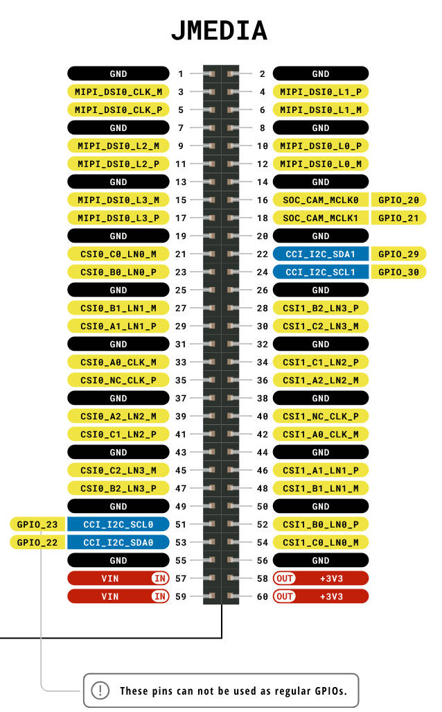

# JMEDIA 连接 Camera × 2 和 Display × 1 接线说明

JMEDIA 提供 **CSI0** 和 **CSI1** 两路 MIPI CSI 摄像头接口，以及 **MIPI DSI0** 一路显示接口，同时配备两组独立 CCI I2C 总线，可同时驱动两个 Camera 和一个 Display。



---

## 一、CAMERA 0（J3 连接器）→ CSI0 通道

Camera 0 使用 **CSI0** 通道 + **CCI_I2C_SCL0 / SDA0**

| J3 引脚 | J3 信号名 | JMEDIA 引脚 | JMEDIA 信号名 |
|--------|-----------|------------|--------------|
| 1 | GND | 任意 GND 脚 | GND |
| 2 | CAM0_DN0 | 21 | CSI0_C0_LN0_M |
| 3 | CAM0_DP0 | 23 | CSI0_B0_LN0_P |
| 4 | GND | 任意 GND 脚 | GND |
| 5 | CAM0_DN1 | 27 | CSI0_B1_LN1_M |
| 6 | CAM0_DP1 | 29 | CSI0_A1_LN1_P |
| 7 | GND | 任意 GND 脚 | GND |
| 8 | CAM0_CN | 33 | CSI0_A0_CLK_M |
| 9 | CAM0_CP | 35 | CSI0_NC_CLK_P |
| 10 | GND | 任意 GND 脚 | GND |
| 11 | CAM_GPIO0 | 16 | SOC_CAM_MCLK0 (GPIO_20) |
| 12 | CAM_GPIO1 | — | NC（可选） |
| 13 | SCL0 | 51 | CCI_I2C_SCL0 (GPIO_23) |
| 14 | SDA0 | 53 | CCI_I2C_SDA0 (GPIO_22) |
| 15 | 3V3 | 58 或 60 | +3V3 (OUT) |
| 16–30 | NC | — | — |

---

## 二、CAMERA 1（J3 连接器）→ CSI1 通道

Camera 1 使用 **CSI1** 通道 + **CCI_I2C_SCL1 / SDA1**

| J3 引脚 | J3 信号名 | JMEDIA 引脚 | JMEDIA 信号名 |
|--------|-----------|------------|--------------|
| 1 | GND | 任意 GND 脚 | GND |
| 2 | CAM1_DN0 | 54 | CSI1_C0_LN0_M |
| 3 | CAM1_DP0 | 52 | CSI1_B0_LN0_P |
| 4 | GND | 任意 GND 脚 | GND |
| 5 | CAM1_DN1 | 48 | CSI1_B1_LN1_M |
| 6 | CAM1_DP1 | 46 | CSI1_A1_LN1_P |
| 7 | GND | 任意 GND 脚 | GND |
| 8 | CAM1_CN | 42 | CSI1_A0_CLK_M |
| 9 | CAM1_CP | 40 | CSI1_NC_CLK_P |
| 10 | GND | 任意 GND 脚 | GND |
| 11 | CAM_GPIO0 | 18 | SOC_CAM_MCLK1 (GPIO_21) |
| 12 | CAM_GPIO1 | — | NC（可选） |
| 13 | SCL0 | 24 | CCI_I2C_SCL1 (GPIO_30) |
| 14 | SDA0 | 22 | CCI_I2C_SDA1 (GPIO_29) |
| 15 | 3V3 | 58 或 60 | +3V3 (OUT) |
| 16–30 | NC | — | — |

---

## 三、DISPLAY（J4 连接器）→ DSI0 通道

Display 使用 **MIPI DSI0** 通道 + **CCI_I2C_SCL0 / SDA0**

| J4 引脚 | J4 信号名 | JMEDIA 引脚 | JMEDIA 信号名 |
|--------|-----------|------------|--------------|
| 1 | GND | 任意 GND 脚 | GND |
| 2 | DSI1_DN1 | 6 | MIPI_DSI0_L1_M |
| 3 | DSI1_DP1 | 4 | MIPI_DSI0_L1_P |
| 4 | GND | 任意 GND 脚 | GND |
| 5 | DSI1_CN | 3 | MIPI_DSI0_CLK_M |
| 6 | DSI1_CP | 5 | MIPI_DSI0_CLK_P |
| 7 | GND | 任意 GND 脚 | GND |
| 8 | DSI1_DN0 | 12 | MIPI_DSI0_L0_M |
| 9 | DSI1_DP0 | 10 | MIPI_DSI0_L0_P |
| 10 | GND | 任意 GND 脚 | GND |
| 11 | SCL0 | 51 | CCI_I2C_SCL0 (GPIO_23) |
| 12 | SDA0 | 53 | CCI_I2C_SDA0 (GPIO_22) |
| 13 | GND | 任意 GND 脚 | GND |
| 14 | GND | 任意 GND 脚 | GND |
| 15 | 3V3 | 58 或 60 | +3V3 (OUT) |
| 16–30 | NC | — | — |

---

## 四、信号通道总览

| 外设 | 数据通道 | I2C 总线 | MCLK |
|------|---------|---------|------|
| Camera 0 | CSI0（2-lane） | CCI_I2C0（Pin 51/53） | MCLK0（Pin 16） |
| Camera 1 | CSI1（2-lane） | CCI_I2C1（Pin 24/22） | MCLK1（Pin 18） |
| Display | MIPI DSI0（2-lane） | CCI_I2C0（Pin 51/53） | — |

> **注意**：Display 与 Camera 0 共用 CCI_I2C0，需确保两者 I2C 设备地址不冲突。Camera 1 独占 CCI_I2C1，无冲突风险。

---

## 五、关键注意事项

1. **差分信号极性**：MIPI CSI/DSI 均为差分信号，M/N 为负极，P 为正极，连接时不可接反。
2. **两路 I2C 独立**：Camera 0 和 Display 共用 CCI_I2C0（Pin 51/53），Camera 1 独用 CCI_I2C1（Pin 24/22），两路 I2C 互不干扰。
3. **电源**：3V3 由 JMEDIA 的 Pin 58/60 输出（OUT），VIN（Pin 57/59）为输入电源，不要将 3V3 接到 VIN 引脚。两个 Camera 和 Display 均可从 Pin 58 或 60 取电，注意总电流不超过额定值。
4. **GND**：JMEDIA 上 Pin 1、2、7、8、13、14、19、20、25、26、31、32、37、38、43、44、49、50、55、56 均为 GND，就近选用即可。
5. **MCLK**：Camera 0 使用 MCLK0（Pin 16），Camera 1 使用 MCLK1（Pin 18），各自独立，如 Camera 模组不需要外部 MCLK 可不连。
6. **4-lane 扩展**：CSI0 和 CSI1 均支持最多 4-lane，当前接线仅使用 Lane0 + Lane1（2-lane），如需 4-lane 可额外连接 Lane2（Pin 39/41）和 Lane3（Pin 45/47）for CSI0，Lane2（Pin 36/34）和 Lane3（Pin 30/28）for CSI1。

---

## 六、转接板 PCB 布线注意事项

### 6.1 差分对阻抗控制

| 信号类型 | 差分阻抗目标 | 单端阻抗参考 |
|---------|------------|------------|
| MIPI CSI（数据/时钟） | 100 Ω ± 10% | 50 Ω |
| MIPI DSI（数据/时钟） | 100 Ω ± 10% | 50 Ω |

- 需根据 PCB 叠层（板厚、铜厚、介质 Dk）计算走线宽度和间距，建议使用阻抗计算工具（如 Saturn PCB Toolkit）提前确认。
- 推荐使用 **4 层板**（Top / GND / PWR / Bottom），差分信号走 Top 层，紧邻 GND 参考平面。

---

### 6.2 差分对等长匹配

- **对内等长（Intra-pair）**：同一差分对的 P/N 两根线长度差 ≤ **0.1 mm**（约 5 mil），否则会引入共模噪声。
- **对间等长（Inter-pair）**：同一 CSI/DSI 接口的所有 Lane 与时钟对之间，长度差 ≤ **5 mm**（MIPI 规范允许范围内）。
- 使用蛇形走线（Serpentine）补偿长度差，蛇形间距 ≥ 3 倍线宽，避免串扰。

---

### 6.3 差分对走线规则

- 差分对内两根线**全程紧耦合**，间距保持一致（建议 = 线宽，即 1:1 间距），不可中途分开再合并。
- 差分对走线尽量**短而直**，避免直角转弯，使用 45° 或圆弧转角。
- 差分对之间（Lane0 与 Lane1、数据与时钟）保持 ≥ **3 倍线宽** 的间距，防止 Lane 间串扰。
- CSI0、CSI1、DSI0 三组信号之间保持 ≥ **20 mil** 隔离间距，或用 GND 铜皮隔开。

---

### 6.4 参考平面完整性

- 差分信号走线下方的 GND 参考平面必须**完整无分割**，不得有过孔、铜皮缺口穿越差分对正下方。
- 如必须换层，过孔旁边紧邻放置 **GND 回流过孔**（每个信号过孔旁至少 1 个 GND 过孔），减少回流路径阻断。
- 尽量避免差分信号换层，若必须换层，两根线同时换层，且过孔尺寸一致。

---

### 6.5 连接器选型与布局

- JMEDIA 60-pin 连接器和 Camera/Display 30-pin 连接器（1-1734248-5）均为高密度 FPC/BTB 连接器，焊盘间距小，需注意焊接工艺。
- 连接器尽量靠近板边放置，减少信号走线长度。
- Camera 0（J3_0）和 Camera 1（J3_1）连接器建议分布在板的两侧，避免两组 CSI 信号交叉走线。
- Display（J4）连接器与 JMEDIA DSI 引脚区域对齐，缩短 DSI 走线。

---

### 6.6 电源与去耦

- 3V3 电源（JMEDIA Pin 58/60）到各连接器 3V3 引脚之间，走线宽度 ≥ **0.5 mm**（承载多个外设电流）。
- 每个连接器的 3V3 引脚旁放置去耦电容：**100 nF（0402）+ 10 µF（0805）** 并联，尽量靠近引脚放置。
- VIN 输入（Pin 57/59）与 3V3 输出之间若有板载 LDO，LDO 输入/输出端各加 10 µF 电容。
- 电源走线与高速差分信号保持 ≥ **20 mil** 间距。

---

### 6.7 I2C 走线

- CCI_I2C 为低速信号（最高 400 kHz / 1 MHz），走线要求宽松，但仍需注意：
  - 走线长度 ≤ **30 cm**（板内通常远小于此值，无需担心）。
  - SCL/SDA 走线旁预留上拉电阻位置（1.8 kΩ 或 4.7 kΩ 上拉至 3V3），若外设模组已内置上拉则可不加。
  - I2C 走线远离 CSI/DSI 差分信号，避免高速信号对 I2C 产生干扰。

---

### 6.8 MCLK 走线

- SOC_CAM_MCLK0/1 为单端时钟信号（通常 24 MHz 或 27 MHz），走线阻抗控制在 **50 Ω**。
- MCLK 走线旁加 GND 保护铜皮或 GND 走线，避免辐射干扰 CSI 差分信号。
- MCLK 走线长度两路尽量一致（Camera 0 和 Camera 1 的 MCLK 走线等长）。

---

### 6.9 整体布局建议

```
┌─────────────────────────────────────────┐
│  [Camera 0 J3_0]   [Camera 1 J3_1]      │
│       │                  │              │
│   CSI0 差分对         CSI1 差分对        │
│   (GND 隔离带)        (GND 隔离带)       │
│       │                  │              │
│   ────────────────────────────          │
│              JMEDIA 60-pin              │
│   ────────────────────────────          │
│              DSI0 差分对                │
│                  │                      │
│           [Display J4]                  │
└─────────────────────────────────────────┘
```

- Camera 连接器在上，Display 连接器在下，JMEDIA 居中，信号流向清晰，避免绕线。
- 三组高速信号（CSI0 / CSI1 / DSI0）之间用 GND 铜皮隔离带分开。
- I2C、MCLK、电源走线布置在高速信号区域外侧。

---

## 七、JMEDIA 引脚速查（全部相关信号）

| JMEDIA 引脚 | 信号名 | 用途 |
|------------|--------|------|
| 3 | MIPI_DSI0_CLK_M | Display 时钟负 |
| 4 | MIPI_DSI0_L1_P | Display Lane1 正 |
| 5 | MIPI_DSI0_CLK_P | Display 时钟正 |
| 6 | MIPI_DSI0_L1_M | Display Lane1 负 |
| 10 | MIPI_DSI0_L0_P | Display Lane0 正 |
| 12 | MIPI_DSI0_L0_M | Display Lane0 负 |
| 16 | SOC_CAM_MCLK0 (GPIO_20) | Camera 0 主时钟 |
| 18 | SOC_CAM_MCLK1 (GPIO_21) | Camera 1 主时钟 |
| 21 | CSI0_C0_LN0_M | Camera 0 Lane0 负 |
| 22 | CCI_I2C_SDA1 (GPIO_29) | Camera 1 I2C 数据 |
| 23 | CSI0_B0_LN0_P | Camera 0 Lane0 正 |
| 24 | CCI_I2C_SCL1 (GPIO_30) | Camera 1 I2C 时钟 |
| 27 | CSI0_B1_LN1_M | Camera 0 Lane1 负 |
| 29 | CSI0_A1_LN1_P | Camera 0 Lane1 正 |
| 33 | CSI0_A0_CLK_M | Camera 0 时钟负 |
| 35 | CSI0_NC_CLK_P | Camera 0 时钟正 |
| 39 | CSI0_A2_LN2_M | Camera 0 Lane2 负（4-lane 可选） |
| 41 | CSI0_C1_LN2_P | Camera 0 Lane2 正（4-lane 可选） |
| 45 | CSI0_C2_LN3_M | Camera 0 Lane3 负（4-lane 可选） |
| 47 | CSI0_B2_LN3_P | Camera 0 Lane3 正（4-lane 可选） |
| 40 | CSI1_NC_CLK_P | Camera 1 时钟正 |
| 42 | CSI1_A0_CLK_M | Camera 1 时钟负 |
| 46 | CSI1_A1_LN1_P | Camera 1 Lane1 正 |
| 48 | CSI1_B1_LN1_M | Camera 1 Lane1 负 |
| 51 | CCI_I2C_SCL0 (GPIO_23) | Camera 0 & Display I2C 时钟 |
| 52 | CSI1_B0_LN0_P | Camera 1 Lane0 正 |
| 53 | CCI_I2C_SDA0 (GPIO_22) | Camera 0 & Display I2C 数据 |
| 54 | CSI1_C0_LN0_M | Camera 1 Lane0 负 |
| 28 | CSI1_B2_LN3_P | Camera 1 Lane3 正（4-lane 可选） |
| 30 | CSI1_C2_LN3_M | Camera 1 Lane3 负（4-lane 可选） |
| 34 | CSI1_C1_LN2_P | Camera 1 Lane2 正（4-lane 可选） |
| 36 | CSI1_A2_LN2_M | Camera 1 Lane2 负（4-lane 可选） |
| 58 / 60 | +3V3 (OUT) | 3.3V 电源输出 |
| 57 / 59 | VIN (IN) | 电源输入 |