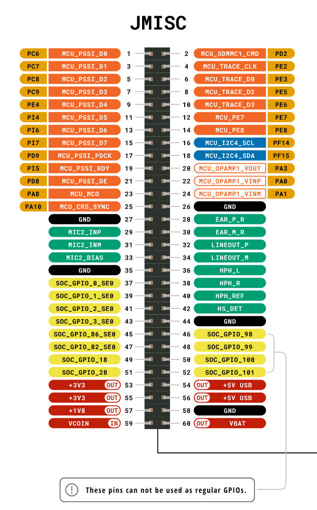

# JMISC 接口功能说明

JMISC 是一个 60-pin 综合功能扩展接口，集成了 **并行摄像头、音频、MCU 调试、I2C、运算放大器、GPIO、多路电源** 等功能，是 JMEDIA 的补充接口。

---

## 一、接口功能总览

| 功能模块 | 信号数量 | 主要用途 |
|---------|---------|---------|
| PSSI 并行摄像头 | 11 路 | 连接并行输出摄像头模组 |
| 音频（MIC + 耳机 + 线路输出） | 9 路 | 麦克风输入、耳机/线路音频输出 |
| MCU Trace 调试 | 5 路 | ETM/ITM 实时调试跟踪 |
| MCU I2C4 | 2 路 | MCU 侧 I2C 设备挂载 |
| MCU OPAMP1 | 3 路 | 片内运算放大器模拟信号处理 |
| MCU 时钟输出（MCO） | 1 路 | 为外部设备提供 MCU 时钟 |
| MCU CRS_SYNC | 1 路 | USB 时钟恢复同步 |
| MCU SDMMC1_CMD | 1 路 | SD/MMC 存储卡命令线 |
| SOC GPIO | 10 路 | SOC 通用 GPIO 扩展 |
| MCU GPIO | 2 路 | MCU 通用 GPIO（PE7/PE8） |
| 电源输出 | 6 路 | 3.3V / 1.8V / 5V USB / VBAT |
| 电源输入 | 1 路 | VCOIN（RTC/纽扣电池） |

---

## 二、各功能模块详解

### 2.1 PSSI 并行摄像头接口

**可用于**：连接并行输出的摄像头模组，如 OV7670、OV2640、MT9V034 等。

| JMISC 引脚 | 信号名 | GPIO | 说明 |
|-----------|--------|------|------|
| 1 | MCU_PSSI_D0 | PC6 | 数据位 0 |
| 3 | MCU_PSSI_D1 | PC7 | 数据位 1 |
| 5 | MCU_PSSI_D2 | PC8 | 数据位 2 |
| 7 | MCU_PSSI_D3 | PC9 | 数据位 3 |
| 9 | MCU_PSSI_D4 | PE4 | 数据位 4 |
| 11 | MCU_PSSI_D5 | PI4 | 数据位 5 |
| 13 | MCU_PSSI_D6 | PI6 | 数据位 6 |
| 15 | MCU_PSSI_D7 | PI7 | 数据位 7 |
| 17 | MCU_PSSI_PDCK | PD9 | 像素时钟 |
| 19 | MCU_PSSI_RDY | PI5 | 就绪信号 |
| 21 | MCU_PSSI_DE | PD8 | 数据使能 |

> **典型应用**：OV7670（8-bit 并行 VGA 摄像头）、OV2640（JPEG 输出摄像头）、工业并行图像传感器。

---

### 2.2 音频接口

**可用于**：麦克风采集、耳机播放、线路音频输出，配合板载音频 CODEC 芯片使用。

| JMISC 引脚 | 信号名 | 说明 |
|-----------|--------|------|
| 29 | MIC2_INP | 麦克风 2 差分正输入 |
| 31 | MIC2_INM | 麦克风 2 差分负输入 |
| 33 | MIC2_BIAS | 麦克风偏置电压 |
| 28 | EAR_P_R | 耳机右声道正输出 |
| 30 | EAR_M_R | 耳机右声道负输出 |
| 32 | LINEOUT_P | 线路输出正 |
| 34 | LINEOUT_M | 线路输出负 |
| 36 | HPH_L | 耳机左声道输出 |
| 38 | HPH_R | 耳机右声道输出 |
| 40 | HPH_REF | 耳机参考电压 |
| 42 | HS_DET | 耳机插入检测 |

> **典型应用**：
> - 连接驻极体麦克风（MIC2_INP/INM + MIC2_BIAS）
> - 连接 3.5mm 耳机插座（HPH_L/R + HPH_REF）
> - 连接外部功放（LINEOUT_P/M）
> - 耳机热插拔检测（HS_DET）

---

### 2.3 MCU Trace 调试接口

**可用于**：连接 J-Trace / ULINK 等调试器，实现 ETM（嵌入式跟踪宏单元）实时指令跟踪，用于性能分析和代码覆盖率测试。

| JMISC 引脚 | 信号名 | GPIO | 说明 |
|-----------|--------|------|------|
| 4 | MCU_TRACE_CLK | PE2 | Trace 时钟 |
| 6 | MCU_TRACE_D0 | PE3 | Trace 数据位 0 |
| 8 | MCU_TRACE_D1 | PE5 | Trace 数据位 1 |
| 10 | MCU_TRACE_D2 | PE6 | Trace 数据位 2 |
| 12 | MCU_TRACE_D3 | PE7 | Trace 数据位 3 |

> **典型应用**：配合 Keil MDK / IAR / Ozone 调试器，实现 4-bit 并行 ETM Trace，用于实时性能分析、中断延迟测量、代码覆盖率统计。

---

### 2.4 MCU I2C4 接口

**可用于**：挂载 MCU 侧的 I2C 外设，与 SOC 侧 CCI_I2C 相互独立。

| JMISC 引脚 | 信号名 | GPIO | 说明 |
|-----------|--------|------|------|
| 16 | MCU_I2C4_SCL | PF14 | I2C4 时钟 |
| 18 | MCU_I2C4_SDA | PF15 | I2C4 数据 |

> **典型应用**：连接 EEPROM（AT24Cxx）、温湿度传感器（SHT30）、IMU（MPU6050）、OLED 显示屏等 I2C 设备，由 MCU 直接控制。

---

### 2.5 MCU OPAMP1（片内运算放大器）

**可用于**：模拟信号放大、跟随器、差分放大、低通滤波等模拟前端电路。

| JMISC 引脚 | 信号名 | GPIO | 说明 |
|-----------|--------|------|------|
| 20 | MCU_OPAMP1_VOUT | PA3 | 运放输出 |
| 22 | MCU_OPAMP1_VINP | PA0 | 运放正输入 |
| 24 | MCU_OPAMP1_VINM | PA1 | 运放负输入 |

> **典型应用**：
> - 传感器信号放大（应变片、热电偶前端）
> - 电压跟随器（阻抗匹配）
> - 与 MCU 内置 ADC 配合，构成高精度模拟采集通道

---

### 2.6 MCU 时钟输出（MCO）

| JMISC 引脚 | 信号名 | GPIO | 说明 |
|-----------|--------|------|------|
| 23 | MCU_MCO | PA8 | MCU 时钟输出 |

> **典型应用**：为外部芯片（摄像头 XCLK、音频 CODEC MCLK、FPGA 参考时钟）提供由 MCU 生成的时钟信号，频率可通过 MCU 寄存器配置。

---

### 2.7 MCU CRS_SYNC（USB 时钟恢复）

| JMISC 引脚 | 信号名 | GPIO | 说明 |
|-----------|--------|------|------|
| 25 | MCU_CRS_SYNC | PA10 | CRS 外部同步输入 |

> **典型应用**：利用 USB SOF 信号自动校准 MCU 内部 HSI48 时钟，用于 USB Full-Speed 设备的时钟精度补偿。

---

### 2.8 MCU SDMMC1_CMD

| JMISC 引脚 | 信号名 | GPIO | 说明 |
|-----------|--------|------|------|
| 2 | MCU_SDMMC1_CMD | PD2 | SDMMC1 命令线 |

> **说明**：SDMMC1 的命令线引出，配合其他 SDMMC 数据线（CLK/D0~D3）可扩展 SD 卡存储，通常需结合其他接口的 SDMMC 引脚共同使用。

---

### 2.9 SOC 通用 GPIO

**可用于**：按键、LED、继电器控制、SPI/UART 软件模拟、PWM 输出等。

| JMISC 引脚 | 信号名 | 说明 |
|-----------|--------|------|
| 37 | SOC_GPIO_0_SE0 | SOC GPIO 0 |
| 39 | SOC_GPIO_1_SE0 | SOC GPIO 1 |
| 41 | SOC_GPIO_2_SE0 | SOC GPIO 2 |
| 43 | SOC_GPIO_3_SE0 | SOC GPIO 3 |
| 45 | SOC_GPIO_86_SE0 | SOC GPIO 86 |
| 47 | SOC_GPIO_82_SE0 | SOC GPIO 82 |
| 49 | SOC_GPIO_18 | SOC GPIO 18 |
| 51 | SOC_GPIO_28 | SOC GPIO 28 |
| 46 | SOC_GPIO_98 | SOC GPIO 98 |
| 48 | SOC_GPIO_99 | SOC GPIO 99 |
| 50 | SOC_GPIO_100 | SOC GPIO 100 |
| 52 | SOC_GPIO_101 | SOC GPIO 101 |

---

### 2.10 电源引脚

| JMISC 引脚 | 信号名 | 方向 | 说明 |
|-----------|--------|------|------|
| 53 / 55 | +3V3 | OUT | 3.3V 电源输出 |
| 57 | +1V8 | OUT | 1.8V 电源输出（用于低压 IO 外设） |
| 54 / 56 | +5V USB | OUT | 5V USB 电源输出 |
| 60 | VBAT | OUT | 电池电压输出 |
| 59 | VCOIN | IN | 纽扣电池 / RTC 备用电源输入 |
| 27 / 35 / 44 / 58 | GND | — | 接地 |

---

## 三、典型应用场景

| 应用场景 | 使用的 JMISC 功能 |
|---------|-----------------|
| 并行摄像头图像采集 | PSSI（D0~D7 + PDCK + RDY + DE）+ MCU_MCO（提供 XCLK）+ MCU_I2C4（配置寄存器） |
| 语音交互设备 | MIC2_INP/INM + MIC2_BIAS（麦克风输入）+ HPH_L/R（耳机输出）+ HS_DET（插拔检测） |
| 音频播放器 | LINEOUT_P/M（接外部功放）+ HPH_L/R（接耳机） |
| 模拟传感器采集 | OPAMP1_VINP/VINM（信号输入）+ OPAMP1_VOUT（放大输出接 ADC） |
| MCU 固件调试分析 | TRACE_CLK + TRACE_D0~D3（接 J-Trace 调试器） |
| GPIO 扩展控制 | SOC_GPIO_0~3_SE0 / SOC_GPIO_18/28/82/86/98~101 |
| 低功耗 RTC 保持 | VCOIN（接纽扣电池，断电后维持 RTC 走时） |
| 外部芯片供电 | +3V3 / +1V8 / +5V USB 输出 |

---

## 四、与 JMEDIA 接口的分工对比

| 功能 | JMEDIA | JMISC |
|------|--------|-------|
| MIPI CSI 摄像头 | ✅ CSI0 + CSI1（串行高速） | ❌ |
| 并行摄像头 | ❌ | ✅ PSSI（8-bit 并行） |
| MIPI DSI 显示 | ✅ DSI0 | ❌ |
| 音频 | ❌ | ✅ MIC + 耳机 + 线路输出 |
| MCU 调试 Trace | ❌ | ✅ ETM 4-bit Trace |
| MCU I2C | ❌ | ✅ I2C4 |
| SOC I2C（CCI） | ✅ CCI_I2C0 + CCI_I2C1 | ❌ |
| 运算放大器 | ❌ | ✅ OPAMP1 |
| GPIO 扩展 | ❌ | ✅ SOC GPIO × 12 |
| 电源输出 | ✅ 3.3V | ✅ 3.3V / 1.8V / 5V / VBAT |